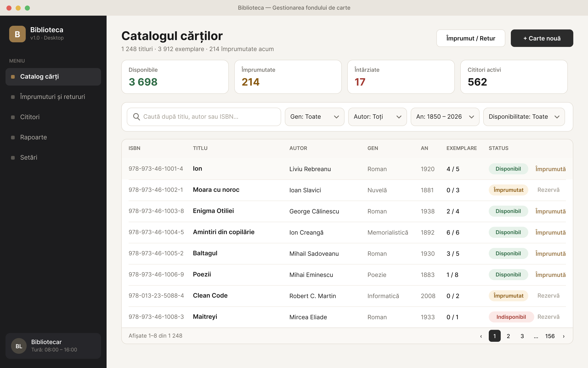
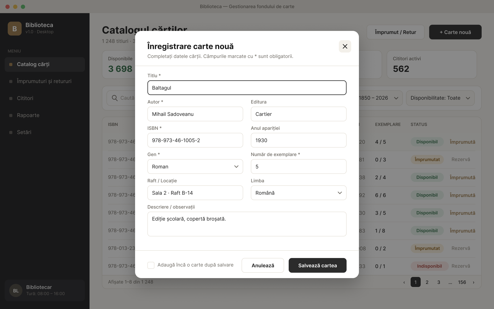
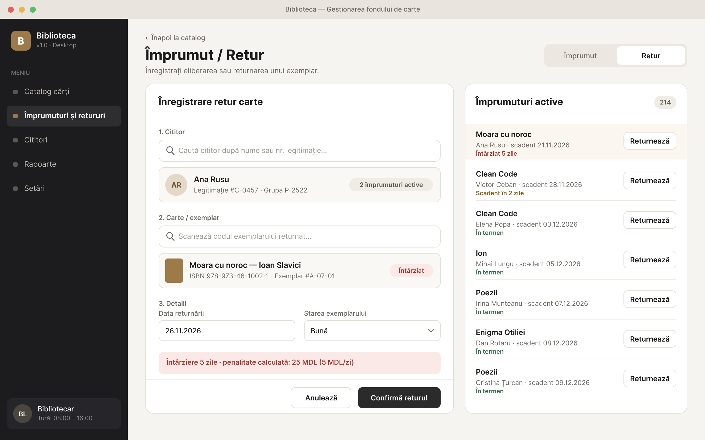
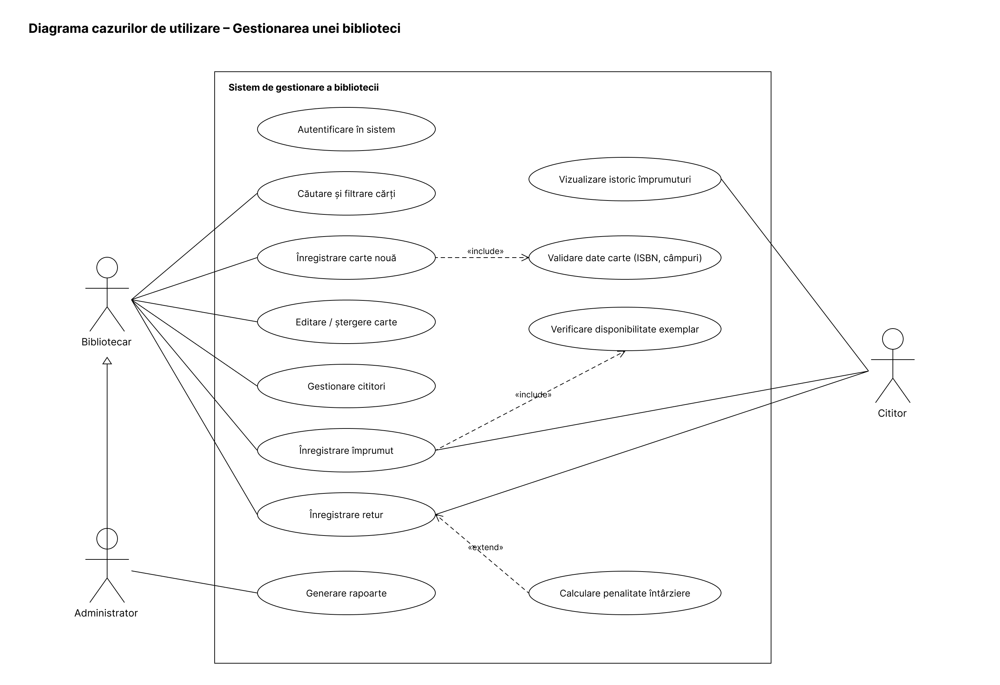

# Gestiune-Biblioteca-Desktop

Aplicație desktop pentru **gestionarea unei biblioteci**: evidența fondului de carte, a cititorilor și a împrumuturilor/retururilor.

> **Laboratorul 7**, Planificarea aplicațiilor desktop
> Țîgîrlaș Sergiu · grupa P-2522 · CEITI

---

## Prototipul Figma

- **Prototip interactiv (Prototype / Present):** https://www.figma.com/proto/fNgNvbk7SX0JIvGZVJrc2l/Laborator-7---Gestionarea-unei-biblioteci--PAD-?node-id=2-2&starting-point-node-id=2%3A2
- **Fișierul de design:** https://www.figma.com/design/fNgNvbk7SX0JIvGZVJrc2l/Laborator-7---Gestionarea-unei-biblioteci--PAD-
- **Export PDF (toate ecranele și diagramele):** [`prototype/Prototip-Figma-Gestiune-Biblioteca.pdf`](prototype/Prototip-Figma-Gestiune-Biblioteca.pdf)

### Ecrane (legate interactiv în modul Prototype)

| # | Ecran | Ce conține |
|---|---|---|
| 01 | **Catalogul cărților** | statistici, zonă de căutare (titlu/autor/ISBN) și filtre (gen, autor, an, disponibilitate), tabelul cărților, paginare |
| 02 | **Fereastra modală „Carte nouă”** | formular cu validare: titlu, autor, editura, ISBN, an, gen, nr. exemplare, raft, limba, descriere |
| 03 | **Înregistrare împrumut** | selectare cititor și exemplar, termen de returnare (14 zile), lista împrumuturilor active |
| 04 | **Înregistrare retur** | exemplarul returnat, starea lui, penalitatea calculată automat pentru întârziere |






### Fluxul de navigare

```
01 Catalog ──「+ Carte nouă」──────────────▶ 02 Modal Carte nouă ──「Salvează / Anulează / ×」──▶ 01
01 Catalog ──「Împrumut / Retur」「Împrumută」──▶ 03 Împrumut ◀──「tab Împrumut / Retur」──▶ 04 Retur
03 / 04   ──「Înregistrează / Confirmă / Anulează / ‹ Înapoi」──▶ 01 Catalog
```

---

## Diagrama UML a cazurilor de utilizare

**Actori:** Bibliotecar (principal), Administrator (generalizare a Bibliotecarului, plus rapoarte), Cititor (secundar).
**Relații:** *Înregistrare împrumut* «include» *Verificare disponibilitate*; *Înregistrare carte nouă* «include» *Validare date*; *Calculare penalitate* «extend» *Înregistrare retur*.



---

## Arhitectura modulară

Arhitectură stratificată (3-tier) cu **MVVM** în stratul de prezentare. Fiecare strat comunică doar cu stratul de sub el, prin interfețe (Dependency Injection).

```
┌──────────────────────────────────────────────────────────────┐
│ 1. PREZENTARE (Biblioteca.UI): WPF, Views + ViewModels       │
│    CatalogView · BookFormDialog · LoanReturnView · ReadersView│
└───────────────▲──────────────────────────────────────────────┘
                │ IBookService, ILoanService … (DI)
┌───────────────┴──────────────────────────────────────────────┐   ┌──────────────────────┐
│ 2. LOGICA APLICAȚIEI (Biblioteca.Services)                   │   │ Biblioteca.Core      │
│    BookService · LoanService · PenaltyService · ReaderService │◀─▶│ (modele de domeniu)  │
│    ReportService · reguli: max 5 cărți, 14 zile, 5 MDL/zi    │   │ Carte · Exemplar     │
└───────────────▲──────────────────────────────────────────────┘   │ Cititor · Împrumut   │
                │ IRepository<T>                                    │ Utilizator           │
┌───────────────┴──────────────────────────────────────────────┐   └──────────────────────┘
│ 3. ACCES LA DATE (Biblioteca.Data)                           │
│    BookRepository · LoanRepository · ReaderRepository        │
│    LibraryDbContext (EF Core) ──▶ SQLite / SQL Server        │
└──────────────────────────────────────────────────────────────┘
```


---

## Structura repository-ului

```
Gestiune-Biblioteca-Desktop/
├── docs/
│   └── specificatii-tehnice.md      # cerințe funcționale/nefuncționale, ecrane, arhitectură
├── diagrams/
│   ├── uml-use-case.png / .pdf      # diagrama cazurilor de utilizare
│   └── arhitectura-modulara.png / .pdf
├── prototype/
│   ├── 01-catalog-carti.png / .pdf
│   ├── 02-modal-carte-noua.png / .pdf
│   ├── 03-imprumut.png / .pdf
│   ├── 04-retur.png / .pdf
│   └── Prototip-Figma-Gestiune-Biblioteca.pdf   # toate ecranele + diagramele
└── README.md
```

## Fluxul Git folosit

```bash
git init -b main
git add . && git commit -m "Structura initiala"
git remote add origin https://github.com/sergiutigirlas00-cell/Gestiune-Biblioteca-Desktop.git
git push -u origin main

git checkout -b feature/prototip-figma-uml      # ramură separată
git add prototype/ diagrams/ README.md
git commit -m "Adauga prototipul Figma si diagrama UML"
git push -u origin feature/prototip-figma-uml
# → Pull Request pe GitHub: feature/prototip-figma-uml → main → Merge
```
