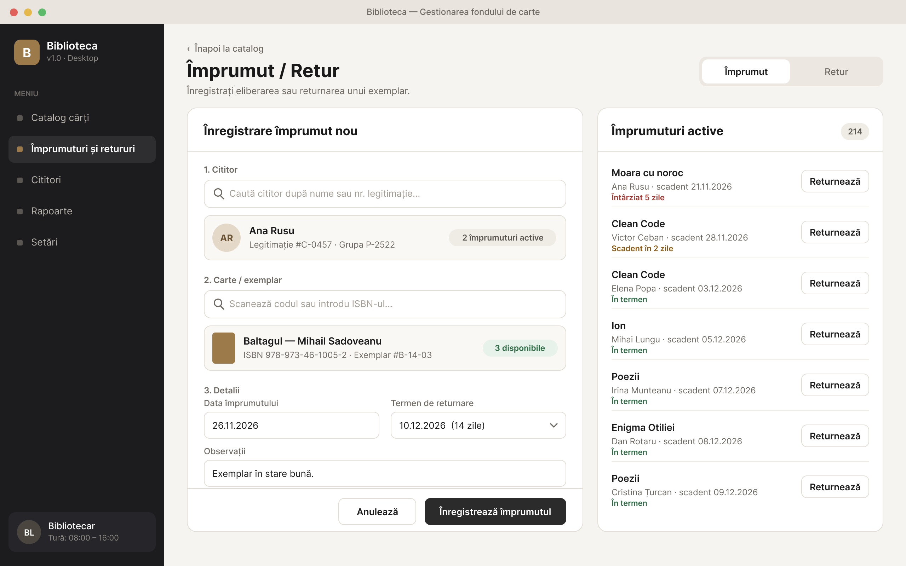
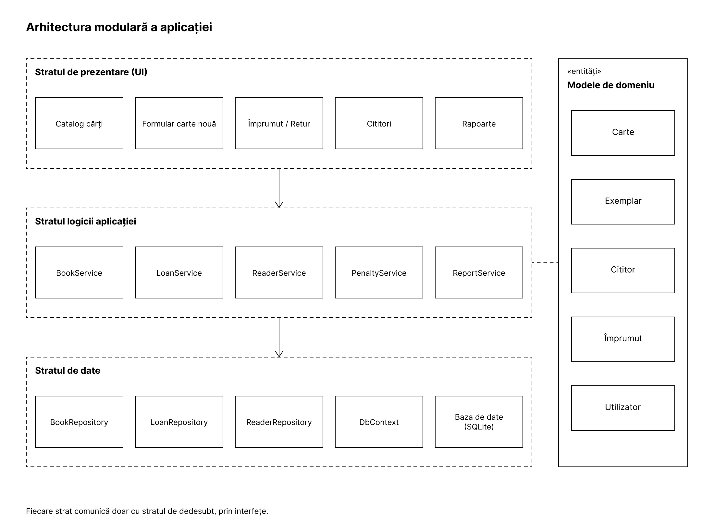

# 📚 Gestiune-Biblioteca-Desktop

Aplicație desktop pentru **gestionarea unei biblioteci**: evidența fondului de carte, a cititorilor și a împrumuturilor/retururilor.

> **Laboratorul 7**, Planificarea aplicațiilor desktop
> Țîgîrlaș Sergiu · grupa P-2522 · CEITI

---

## 🔗 Prototipul Figma

- **Prototip interactiv (Prototype / Present):** https://www.figma.com/proto/fNgNvbk7SX0JIvGZVJrc2l/Laborator-7---Gestionarea-unei-biblioteci--PAD-?node-id=2-2&starting-point-node-id=2%3A2
- **Fișierul de design:** https://www.figma.com/design/fNgNvbk7SX0JIvGZVJrc2l/Laborator-7---Gestionarea-unei-biblioteci--PAD-
- **Export PDF (toate ecranele și diagramele):** [`prototype/Prototip-Figma-Gestiune-Biblioteca.pdf`](prototype/Prototip-Figma-Gestiune-Biblioteca.pdf)

### Ecrane (legate interactiv în modul Prototype)

| # | Ecran | Ce conține |
|---|---|---|
| 01 | **Catalogul cărților** | statistici, zonă de căutare (titlu/autor/ISBN) și filtre (gen, autor, an, disponibilitate), tabelul cărților, paginare |
| 02 | **Fereastra modală „Carte nouă”** | formular cu validare: titlu, autor, editura, ISBN, an, gen, nr. exemplare, raft, limba, descriere |
| 03 | **Înregistrare împrumut** | selectare cititor și exemplar, termen de returnare (14 zile), lista împrumuturilor active |
| 04 | **Înregistrare retur** | exemplarul returnat, starea lui, penalitatea calculată automat pentru întârziere |





### Fluxul de navigare

| Din ecranul | Acțiune (click) | Ajunge la |
|---|---|---|
| 01 Catalog | „+ Carte nouă” | 02 Fereastra modală |
| 01 Catalog | „Împrumut / Retur”, „Împrumută” sau meniul „Împrumuturi și retururi” | 03 Împrumut |
| 02 Fereastra modală | „Salvează cartea”, „Anulează” sau „×” | 01 Catalog |
| 03 Împrumut | tab „Retur” sau „Returnează” | 04 Retur |
| 04 Retur | tab „Împrumut” | 03 Împrumut |
| 03 / 04 | „Înregistrează împrumutul”, „Confirmă returul”, „Anulează”, „‹ Înapoi la catalog” sau meniul „Catalog cărți” | 01 Catalog |

---

## 🧩 Diagrama UML a cazurilor de utilizare

| Actor | Tip | Cazuri de utilizare |
|---|---|---|
| Bibliotecar | principal | UC-01 – UC-07 |
| Administrator | principal (generalizare a Bibliotecarului) | moștenește UC-01 – UC-07, plus UC-08 |
| Cititor | secundar | UC-06, UC-07, UC-09 |

| ID | Caz de utilizare | Relații |
|---|---|---|
| UC-01 | Autentificare în sistem | |
| UC-02 | Căutare și filtrare cărți | |
| UC-03 | Înregistrare carte nouă | «include» UC-10 |
| UC-04 | Editare / ștergere carte | |
| UC-05 | Gestionare cititori | |
| UC-06 | Înregistrare împrumut | «include» UC-11 |
| UC-07 | Înregistrare retur | extins de UC-12 |
| UC-08 | Generare rapoarte | |
| UC-09 | Vizualizare istoric împrumuturi | |
| UC-10 | Validare date carte (ISBN, câmpuri) | inclus în UC-03 |
| UC-11 | Verificare disponibilitate exemplar | inclus în UC-06 |
| UC-12 | Calculare penalitate întârziere | «extend» UC-07 |

**Reguli de business:** maximum 5 cărți per cititor, termen de returnare de 14 zile, penalitate de 5 MDL pentru fiecare zi de întârziere.


---

## 🏗️ Arhitectura modulară

Arhitectură stratificată (3-tier) cu **MVVM** în stratul de prezentare. Fiecare strat comunică doar cu stratul de sub el, prin interfețe injectate (Dependency Injection). Modelele de domeniu sunt comune tuturor straturilor.

| Strat / proiect | Responsabilitate | Module |
|---|---|---|
| **1. Biblioteca.UI** (prezentare) | afișare, validare de formular, comenzi; fără reguli de business | CatalogView (ecran 01), BookFormDialog (02), LoanReturnView (03–04), ReadersView, ReportsView |
| **2. Biblioteca.Services** (logica aplicației) | regulile de business: limite, termene, penalități, disponibilitate | BookService, LoanService, PenaltyService, ReaderService, ReportService |
| **3. Biblioteca.Data** (acces la date) | persistență prin Repository pattern + EF Core | BookRepository, LoanRepository, ReaderRepository, LibraryDbContext, SQLite / SQL Server |
| **Biblioteca.Core** (modele) | entități partajate | Carte, Exemplar, Cititor, Împrumut, Utilizator |

Dependențe: `UI → Services` (prin `IBookService`, `ILoanService` …), `Services → Data` (prin `IRepository<T>`), toate → `Core`.

**Tehnologii:** .NET 8, WPF (MVVM), Entity Framework Core, SQLite.



---

## 📁 Structura repository-ului

```
Gestiune-Biblioteca-Desktop/
├── docs/
│   └── specificatii-tehnice.md      # cerințe funcționale/nefuncționale, ecrane, arhitectură
├── diagrams/
│   ├── uml-use-case.png / .pdf      # diagrama cazurilor de utilizare
│   └── arhitectura-modulara.png / .pdf
├── prototype/
│   ├── 01-catalog-carti.png / .pdf
│   ├── 02-modal-carte-noua.png / .pdf
│   ├── 03-imprumut.png / .pdf
│   ├── 04-retur.png / .pdf
│   └── Prototip-Figma-Gestiune-Biblioteca.pdf   # toate ecranele + diagramele
└── README.md
```

## 🌿 Fluxul Git folosit

```bash
git init -b main
git add . && git commit -m "Structura initiala"
git remote add origin https://github.com/sergiutigirlas00-cell/Gestiune-Biblioteca-Desktop.git
git push -u origin main

git checkout -b feature/prototip-figma-uml      # ramură separată
git add prototype/ diagrams/ README.md
git commit -m "Adauga prototipul Figma si diagrama UML"
git push -u origin feature/prototip-figma-uml
# → Pull Request pe GitHub: feature/prototip-figma-uml → main → Merge
```

Pull Request-ul de integrare: [#1 · Adauga prototipul Figma, diagrama UML si README](https://github.com/sergiutigirlas00-cell/Gestiune-Biblioteca-Desktop/pull/1) (merged în `main`).
